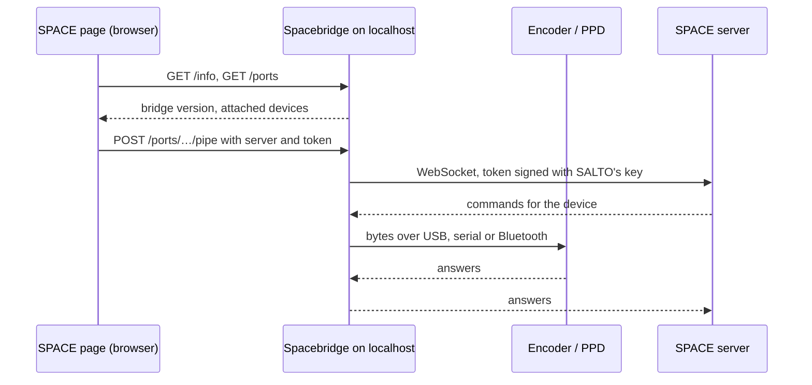

<h1 align="center">Spacebridge</h1>

<p align="center">
  <b>SALTO's Local IO Bridge, for macOS.</b><br>
  Plug an encoder, PPD or nCoder into your Mac and use it from ProAccess SPACE in the browser.
</p>

<p align="center">
  
  
  
  
</p>

<p align="center">
  
</p>

ProAccess SPACE runs in the browser, but encoders plug into your computer. The piece in between is SALTO's *Local IO Bridge*, a small service on `localhost` that SALTO ships for Windows only. Spacebridge is that service for the Mac: it speaks the same protocol, so the SPACE web app finds it and uses it as if it were SALTO's own.

Not affiliated with or endorsed by SALTO Systems.

## Contents

[Install](#install) · [The menu](#the-menu) · [Commands](#commands) · [Who may use the bridge](#who-may-use-the-bridge) · [Devices](#devices) · [How it works](#how-it-works) · [Troubleshooting](#troubleshooting) · [Build from source](#build-from-source) · [Uninstall](#uninstall)

## Install

Apple silicon, macOS 13 or later.

**Homebrew**

```sh
brew tap berrysekk/spacebridge https://github.com/Berrysekk/SaltoSpacebridge-macos
brew install spacebridge
spacebridge
```

**Native install**

```sh
curl -fsSL https://raw.githubusercontent.com/Berrysekk/SaltoSpacebridge-macos/main/install.sh | sh
```

The command lands in a directory that is already on your PATH (`/usr/local/bin` on a new Mac, for which macOS asks your password once), so `spacebridge` works in the same terminal right away. An upgrade through the same command keeps your settings and only updates the service.

**Setting it up**

Both ways end in a guided setup (later: `spacebridge setup`, or the first `spacebridge`). It asks, one screen each, with **Esc** to go back:

1. **Your SPACE**, the address exactly as you type it in the browser, like `https://space.example:8100`. If that SPACE does not hand out SALTO's installer, you can point it at a downloaded `Setup_SaltoLocalIOBridge.exe` instead.
2. **Who may use the bridge**: only your SPACE, or any website as with SALTO's own bridge.
3. **Devices**: serial ports and Bluetooth on or off.
4. **Install**: a summary, then the service.

For scripts, the address skips the questions: `spacebridge setup https://space.example:8100`, or `… | sh -s -- https://space.example:8100`.

Behind those screens, setup does three things:

| | |
|---|---|
| **1. Fetches SALTO's signing key** | Every SPACE serves SALTO's own bridge installer (`/ProAccessSpace/Setup_SaltoLocalIOBridge.exe`). The key the bridge signs its connections with is read out of it; it is not part of this repository or of the releases. A downloaded installer works too: `spacebridge key import ~/Downloads/Setup_SaltoLocalIOBridge.exe`. |
| **2. Allows that SPACE** | Only pages from that address may use the bridge. See [Who may use the bridge](#who-may-use-the-bridge). |
| **3. Installs the service** | A LaunchAgent that starts at login, and trust for the bridge's own certificate for `https://localhost`, which a SPACE on https needs. macOS asks for your password once. |

Then log in to SPACE again. The first time, the browser asks whether the SPACE page may reach devices on this computer (Chrome: *local network*, Firefox: *apps and services on this device*). Allow it and repeat the action: SPACE gives up after two seconds, so the first try fails while the question is open.

## The menu

```sh
spacebridge
```

Run without a command, Spacebridge opens the menu in the picture above (the very first time, the guided setup comes before it). **↑ ↓** move, **Enter** or **→** picks, **Esc** or **←** goes back.

| Section | What is there |
|---|---|
| **Status** (top) | Service, certificate and attached devices. It refreshes on its own: plug an encoder in and it appears. |
| **Access** | The allowed addresses (add, remove, allow one that was refused) and the signing key. |
| **Devices** | Bluetooth and serial ports on or off, and a 15 s Bluetooth scan. |
| **Service** | Start, stop, restart, install or update, uninstall. |
| **Diagnostics** | The live log (which page asked for what, and what it got) and the self-test. |

Anything that takes something away asks first.

## Commands

Everything in the menu is also a command, for scripts and for the impatient.

| Command | |
|---|---|
| `spacebridge status` | What is running, what is allowed, which devices are attached |
| `spacebridge setup` | Guided setup: your SPACE, who may use the bridge, devices, the service |
| `spacebridge setup <address>` | The same without questions: key, allow-list and service in one go |
| `spacebridge devices [--bluetooth]` | Encoders, PPDs, nCoders and serial ports; `--bluetooth` listens 15 s for SALTO devices |
| `spacebridge logs [-f] [-n N] [--all]` | Which page asked for what, and what it got |
| `spacebridge start` · `stop` · `restart` | The background service |
| `spacebridge allow <address>...` | Let only the listed SPACE servers use the bridge |
| `spacebridge allow --any` | Let any website use it, as SALTO's Windows bridge does |
| `spacebridge deny <address>...` | Take an address off the list |
| `spacebridge origins` | Show the list |
| `spacebridge config [bluetooth\|serial on\|off]` | Show or change settings |
| `spacebridge key import <address\|file>` | Take the signing key from a SPACE or from SALTO's installer |
| `spacebridge install` · `uninstall [--all]` | The service; run `install` again after an upgrade |
| `spacebridge selftest` | Check the bridge's own workings; with a device attached it also opens it |

```
$ spacebridge status
Spacebridge 1.1.0 · SALTO Local IO Bridge 2.1.0.0 for macOS

  Service      ● running (pid 2437)  http://localhost:50000  https://localhost:50001
  Certificate  ● trusted for https://localhost until 2029-02-08
  Signing key  ● imported
  Allowed      ● https://space.example:8100
  Bluetooth    off
  Serial ports on

  usb0                   PPD          Portable Programmer Device NFC 020000103417
```

Settings live in `~/Library/Application Support/Spacebridge/config.json`, the log in `~/Library/Logs/Spacebridge.log`.

## Who may use the bridge

SALTO's bridge answers any web page that asks, so a page you happen to visit could open a connection to your encoder. Spacebridge can keep a list instead:

```sh
spacebridge allow https://space.example:8100 http://10.0.0.5:8100
```

- Only pages from those addresses get an answer.
- A connection can only lead back to the page's own server.
- Everything else is refused, and shows up in the menu and in `spacebridge status` with the way to let it in.

`spacebridge allow --any` goes back to SALTO's behaviour. `setup` puts your SPACE on the list (unless you chose any website).

Independently of the list, the bridge listens on loopback only and refuses requests addressed to any name but `localhost`, `127.0.0.1` or `[::1]`.

## Devices

| Device | How it is reached | State |
|---|---|---|
| USB encoder, PPD | Silicon Labs CP210x under SALTO's id `10C4:82E9`, driven through libusb (macOS has no driver for it) | 🟡 listed correctly; a full session against real hardware is still to be confirmed |
| nCoder | USB HID `307E:0164` through HidSharp | 🟡 untested |
| Serial encoders | Any `/dev/cu.*`, 38400 8N1 | 🟡 tested against a pseudo terminal only |
| Bluetooth LE | CoreBluetooth; SALTO's advertisement, GATT service and packet framing ported from the Windows bridge | 🟠 off by default, not yet tried against a SALTO device |

SPACE servers it was tried with: 6.12 (https, bridge 1.5.0) and 6.13 (http, bridge 2.1.0) both find the bridge.

Bluetooth: switch it on in the menu or with `spacebridge config bluetooth on`, then answer macOS's question whether Spacebridge may use Bluetooth.

## How it works



The page only asks the bridge *which* devices there are and to open a pipe. The device traffic itself runs between the SPACE server and the device, through the bridge.

## Troubleshooting

<details>
<summary><b>SPACE says it cannot connect to the Local IO Bridge</b></summary>

Open the live log (menu → Live log, or `spacebridge logs`). If nothing from your SPACE appears, the browser did not reach the bridge: check the browser's permission for the SPACE site (local network / devices on this computer). Then look at the status for the certificate (a SPACE on https needs it trusted) and the allowed addresses.
</details>

<details>
<summary><b><code>refused origin ...</code> in the log, or "refused" in the menu</b></summary>

The page is not on the list. Menu → Allowed addresses, or `spacebridge allow <address>`.
</details>

<details>
<summary><b>Signing key missing</b></summary>

Menu → Signing key, or `spacebridge key import <SPACE address>`.
</details>

<details>
<summary><b>The service is an older version than the command</b> (after <code>brew upgrade</code>)</summary>

Menu → Install or update, or `spacebridge install`.
</details>

<details>
<summary><b>macOS asks about Bluetooth again</b></summary>

It asks once per installed build: the permission is tied to the program's signature, and every build has its own.
</details>

## Build from source

Needs the .NET 9 SDK and Xcode's command line tools.

```sh
./build.sh                                                  # dist/Spacebridge.app and the release archive
dist/Spacebridge.app/Contents/MacOS/spacebridge selftest
dist/Spacebridge.app/Contents/MacOS/spacebridge install
```

`lib/` holds HidSharp (Apache-2.0, the build SALTO ships) and libusb 1.0.30 from Homebrew (LGPL-2.1). The build is ad-hoc signed, not notarised: an archive downloaded with a browser is quarantined by macOS; `install.sh` and Homebrew are not affected.

How the protocol works, what was found in SALTO's bridge and what is still open: Paměť `projects/salto-local-io-bridge-mac/_index` (Totosoft internal).

## Uninstall

```sh
spacebridge uninstall --all     # service, certificate, settings, signing key
brew uninstall spacebridge      # or: rm "$(command -v spacebridge)"
```
