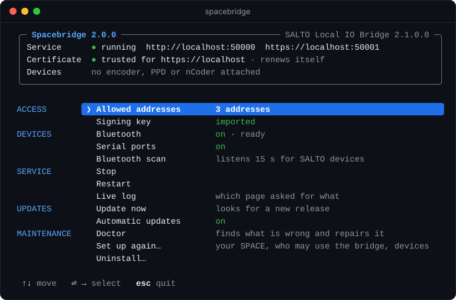

<h1 align="center">Spacebridge</h1>

<p align="center">
  <b>SALTO's Local IO Bridge, for macOS.</b><br>
  Plug an encoder, PPD or nCoder into your Mac and use it from ProAccess SPACE in the browser.
</p>

<p align="center">
  
  
  
</p>

<p align="center">
  
</p>

SPACE runs in the browser, but encoders plug into your computer. SALTO's *Local IO Bridge* connects the two, and SALTO ships it for Windows only. Spacebridge is the same bridge for the Mac: SPACE finds it and uses it as if it were SALTO's own.

## Install

**Native install**

```sh
curl -fsSL https://raw.githubusercontent.com/Berrysekk/SaltoSpacebridge-macos/main/install.sh | sh
```

**Homebrew**

```sh
brew tap berrysekk/spacebridge https://github.com/Berrysekk/SaltoSpacebridge-macos
brew install spacebridge
spacebridge
```

## Set up

The installer ends in a short guided setup. You can repeat it any time with `spacebridge setup`.

| Step | What it asks |
|---|---|
| **1. Your SPACE** | The address as you type it in the browser, like `https://space.example:8100` |
| **2. Who may use the bridge** | Only your SPACE (recommended), or any website |
| **3. Devices** | Serial ports and Bluetooth, on or off |
| **4. Install** | Starts the background service; macOS asks for your password once |

Then log in to SPACE again. The first time, the browser asks whether the page may reach devices on this computer. Allow it and repeat the action.

SALTO's signing key is not part of Spacebridge. Setup reads it from the bridge installer that your own SPACE serves.

## Use

```sh
spacebridge
```

opens the menu in the picture. **↑ ↓** move, **Enter** or **→** picks, **Esc** or **←** goes back. Everything is in there: allowed addresses, devices, the service, the live log.

The same as commands, for scripts:

| Command | What it does |
|---|---|
| `spacebridge status` | What is running, what is allowed, which devices are attached |
| `spacebridge setup [address]` | Guided setup, or without questions when you give the address |
| `spacebridge allow <address>` · `deny <address>` | Change who may use the bridge |
| `spacebridge config bluetooth on` | Switch a setting (`bluetooth`, `serial`, `autoupdate`) |
| `spacebridge doctor` | Finds what keeps the bridge from working and repairs it |
| `spacebridge update` | Installs the latest release now |
| `spacebridge logs -f` | Which page asked for what, live |
| `spacebridge start` · `stop` · `restart` | The background service |
| `spacebridge help` | All commands |

## Who may use the bridge

SALTO's bridge answers any web page that asks, so a page you happen to visit could reach your encoder. Spacebridge answers only the addresses on its list, and a connection can only lead back to the page's own server. A page that was refused shows up in the menu, where one keypress lets it in.

## It looks after itself

- **Updates.** The service looks for a new release every few hours and installs it while no device is in use. `spacebridge config autoupdate off` switches that off. With Homebrew, `brew upgrade spacebridge && spacebridge install` updates it.
- **Certificate.** The certificate for `https://localhost` renews itself. macOS asks for your password once, at the first install, never again.
- **Repairs.** `spacebridge doctor` checks the app, the service, the certificate and the command, repairs what it can, and prints the command for the rest.

## Devices

| Device | State |
|---|---|
| USB encoder, PPD | 🟢 Tested with SPACE 6.12 and 6.13 |
| nCoder | 🟡 Untested |
| Serial encoders | 🟡 Tested against a simulated port only |
| Bluetooth LE | 🟠 Off by default; not yet tried with a SALTO device |

## Troubleshooting

| Problem | Fix |
|---|---|
| Anything that does not work | `spacebridge doctor` |
| SPACE cannot connect to the Local IO Bridge | Open the live log. Nothing from your SPACE there? Allow the SPACE site to reach devices on this computer in the browser's site settings. |
| "refused" in the menu or the log | The page is not on the list: menu → Allowed addresses |
| Signing key missing | Menu → Signing key |
| macOS asks about Bluetooth again | Expected: it asks once per installed version, so also after an update |

## Uninstall

```sh
spacebridge uninstall
```

asks what to remove: the service only, or everything. Scripts use `spacebridge uninstall --all`.

## Build from source

Needs the .NET 9 SDK and Xcode's command line tools.

```sh
./build.sh
dist/Spacebridge.app/Contents/MacOS/spacebridge selftest
```

---

<sub>Not affiliated with or endorsed by SALTO Systems. Bundles HidSharp (Apache-2.0) and libusb (LGPL-2.1). Protocol notes: Paměť <code>projects/salto-local-io-bridge-mac/_index</code> (Totosoft internal).</sub>
